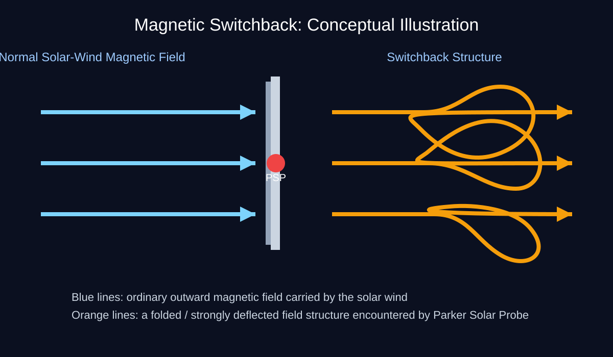

# Project Solar

**Parker Solar Probe — magnetic fields, candidate switchbacks, and energetic particles**

This repository contains the **working FIELDS analysis** for Project Solar. Its
magnetic switchback detector is a **candidate-screening method**, not a validated
physical event classifier. Event segmentation is still under investigation.



## Repository

| Path | Purpose |
|---|---|
| [The_Research.md](The_Research.md) | Research question, methodology and results |
| `code/external_libraries_requirements.txt` | Required Python packages |
| `code/magnetic_data_reader.py` | Read full-cadence FIELDS data and pre-screen arbitrary UTC time intervals; retains lower-cadence readers |
| `code/magnetic_data_visualization.py` | Daily magnetic-field overview plots |
| `code/magnetic_data_analysis.py` | Candidate switchback detector; local or exploratory SPC reference |
| `results/` | Small set of retained detector catalogs and final validation summary |
| `figures/` | Illustrations and figures used in the research document |

**Experimental scripts, raw comparisons, intermediate results and review images
were removed from `main` to reduce clutter. Nothing was destroyed:** the complete
pre-cleanup snapshot remains on
[`archive/pre-cleanup-2026-10-25`](https://github.com/Epic-coder69/project-solar/tree/archive/pre-cleanup-2026-10-25).

## Setup

Run the following commands from the repository root. Python 3.10+ recommended.

```bash
python3 -m venv .venv
source .venv/bin/activate
python -m pip install -r code/external_libraries_requirements.txt
```

Raw NASA CDF data belong in the git-ignored `data/` cache. The loaders use
NASA CDAWeb and fetch missing files when needed; FIELDS high-resolution data
can be large.

## Basic magnetic-field plots

```bash
python code/magnetic_data_reader.py --start 2018-11-06 --days 1 --resolution 1min
python code/magnetic_data_reader.py --start 2018-11-06 --days 1 --resolution 4cyc
python code/magnetic_data_visualization.py --start 2018-11-06 --days 1
```

Both FIELDS products are read through the same module: `get_day(day, resolution="1min")`
or `get_day(day, resolution="4cyc")`. The detector uses the higher-cadence
measurements for event timing and the one-minute measurements for its slowly
varying magnetic reference. This does **not** manufacture high-resolution
data from one-minute averages.

## Scan any time range at full cadence

The reader can pre-screen **one continuous UTC time interval**: minutes,
hours, days, weeks, or months. You do not have to choose the six-hour
CDF files or issue separate commands for each date. NASA publishes
full-cadence MAG RTN measurements in six-hour files; the reader retrieves
only the overlapping segments plus the 100-minute context needed to
estimate the magnetic background. Full-cadence CDFs are cached locally
under ignored data/fields_full/ and never discarded when nothing is detected.

The internal work is streaming and memory-bounded. A 1-second representation
is used for *permissive screening*, preserving original full-resolution
samples on disk for detailed analysis. Candidate windows include five
minutes of surrounding context. Missing or sparse coverage is reported;
these are **not physically confirmed switchback events**.

Run synthetic tests without NASA downloads:

```bash
python code/magnetic_data_reader.py --self-test
```

Request any UTC interval in a single command:

```bash
# Ten minutes
python code/magnetic_data_reader.py --scan --start 2018-11-07T03:30:00 --duration 10m

# Two weeks
python code/magnetic_data_reader.py --scan --start 2018-11-01 --duration 2w

# Three calendar months
python code/magnetic_data_reader.py --scan --start 2018-11-01 --duration 3mo

# Exact start and exclusive end
python code/magnetic_data_reader.py --scan --start 2018-11-06T12:00:00 --end 2018-11-06T15:00:00
```

Output goes into a **single candidate CSV** under data/ for the
requested interval; use --output to set another location. **The reader
updates that CSV after every completed day**, while the following days are
still downloading. A small `.checkpoint.json` sidecar keeps unmerged
candidate windows for resuming an interrupted scan:

```bash
# Start a month-long scan; inspect its CSV while the program continues
python code/magnetic_data_reader.py --scan --start 2018-11-01 --duration 1mo

# If interrupted by Ctrl+C, continue from the last completed day
python code/magnetic_data_reader.py --scan --start 2018-11-01 --duration 1mo --resume
```

The same start/end range and --output path must be used when resuming.
The checkpoint sidecar is removed automatically on successful completion.
Partial days currently in progress are **not** checkpointed; the reader
reprocesses that day if interrupted. Original NASA CDF downloads remain cached.
Scans made before this update cannot be resumed retroactively.

The output contains *preliminary investigation windows*, not scientifically
confirmed switchbacks, and the existing event-window merging can still
combine separate magnetic rotations. There is no fixed duration limit,
but missing NASA data, download sizes, disk space and computing time apply.

**Current division of work:** the reader can now pre-screen full cadence
for arbitrary ranges. The separate magnetic analysis still uses the
older 4-samples-per-cycle measurements; full-cadence detailed physics
analysis and synchronized visualization have not been implemented yet.
The reader's read_full_interval(start,end) exposes the original measured
samples for that later stage.

## Candidate switchback detector

```bash
python code/magnetic_data_analysis.py --self-test
python code/magnetic_data_analysis.py --top 1 --reference local --no-plots
```

The 20 frozen exploratory observation windows are built into
`code/magnetic_data_analysis.py` (no separate `config/` folder). Use `--top 0` to
analyze all of them, or `--top 1` for a quick functional run. To analyze your
own windows, pass `--windows-csv path/to/your.csv` with `start,end,category`
columns. A previous local `data/survey_selected.csv` is **not automatically
loaded**; specify it explicitly with `--windows-csv data/survey_selected.csv`
if you want the original local selection. Results are generated under `data/`
and intentionally are **not automatically committed**.

An **experimental** Parker-spiral comparison is available via
`--reference parker-spc` (requires SWEAP SPC proton velocity/position files).
This is **not** a reproduction of the published SPAN-i-based method.

### Scientific status

- Reading and preprocessing FIELDS magnetic-field vectors: **working**.
- Automatic rotation/switchback *candidate* extraction: **working**.
- Independent validation: **completed exploratory comparison, inconclusive
  detector ranking**; see [holdout findings](results/holdout_findings.md).
- Physically confirmed switchbacks and robust event boundaries: **not yet**.
- Energetic-particle correlation analysis with IS☉IS: **future work**.

**Reproducibility notice:** The high-resolution loading function has been merged into `code/magnetic_data_reader.py`.
The original local `switchback_survey.py` was not tracked in Git; thus
reproduction of the original event catalogs still needs checking against
actual NASA CDF data on the research Mac. The refactor was tested with
simulated CDF arrays but not yet rerun end-to-end on the user's CDF archive.

## Data acknowledgments

PSP/FIELDS magnetometer data from NASA CDAWeb and the FIELDS team.
Scientific background: [FIELDS data portal](https://fields.ssl.berkeley.edu/data/).
Holdout reference: [Martinović et al. catalog](https://doi.org/10.5281/zenodo.4579821).
