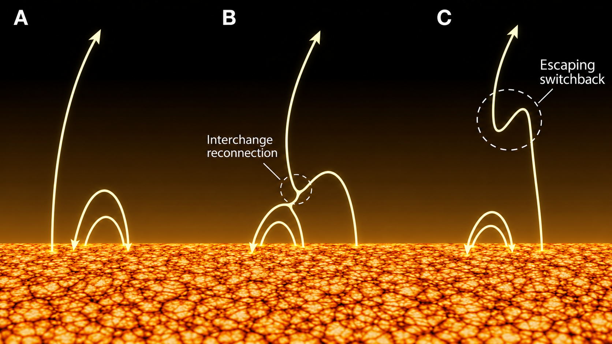

# Project Solar  
## Magnetic Switchbacks and Their Possible Causes

### Introduction

One of the most intriguing discoveries of **Parker Solar Probe (PSP)** is the existence of **magnetic switchbacks** in the near-Sun solar wind.  
A magnetic switchback is a sudden, often large rotation of the magnetic-field direction, sometimes even causing the radial component of the magnetic field to reverse sign temporarily.

In a simple picture, Parker Solar Probe usually observes a magnetic field that points generally outward from the Sun.  
During a switchback, the measured field rotates so strongly that it can briefly point back toward the Sun, before returning to its original direction.

---

### How a switchback appears in the measurements

The magnetic field measured by Parker Solar Probe can be written in RTN coordinates as

$$
\mathbf{B} = B_R \hat{\mathbf{R}} + B_T \hat{\mathbf{T}} + B_N \hat{\mathbf{N}}
$$

and its total magnitude is

$$
|\mathbf{B}| = \sqrt{B_R^2 + B_T^2 + B_N^2}.
$$

A common observational signature of a magnetic switchback is:

- the **direction** of the magnetic field changes dramatically,
- the radial component \( B_R \) may reverse sign,
- but the total magnitude \( |\mathbf{B}| \) often stays approximately constant.

This suggests that the field is **rotating** rather than simply getting stronger or weaker.

---

### Why are switchbacks interesting?

Switchbacks are important because they may reveal how the solar wind is formed, accelerated, and structured close to the Sun.  
They may also help us understand how magnetic energy and plasma dynamics interact in the solar corona and inner heliosphere.

Although switchbacks are directly observed by Parker Solar Probe, their exact physical origin is still under active investigation.

---

### Proposed causes of magnetic switchbacks

Several physical mechanisms have been proposed:

| Proposed cause | Basic idea |
|---|---|
| **Magnetic reconnection** | Reconnection near the Sun may launch bent or kinked magnetic structures outward |
| **Large-amplitude Alfvén waves** | Alfvénic fluctuations may grow until they appear as strong magnetic deflections |
| **Solar-wind turbulence** | Nonlinear turbulent interactions may generate strong directional rotations |
| **Velocity shear / flow distortion** | Different solar-wind streams may distort the magnetic field into folded structures |

These explanations are **not necessarily mutually exclusive**.  
It is possible that switchbacks are created near the Sun and then evolve further as they move outward through the expanding solar wind.

---

### Initial research direction

The first goal of this project is to study magnetic switchbacks in Parker Solar Probe measurements and ask:

1. What observational features distinguish switchbacks from ordinary magnetic fluctuations?
2. How often do switchbacks occur?
3. How does their occurrence vary with distance from the Sun?
4. Which proposed causes are most consistent with the observed properties?

This document will be expanded as the project develops.

---

### Current status

This paper is currently a **starter overview** for Project Solar.  
Future versions will include:

- real Parker Solar Probe data plots,
- quantitative switchback detection methods,
- comparisons with published literature,
- and a more detailed physical discussion of the proposed formation mechanisms.
