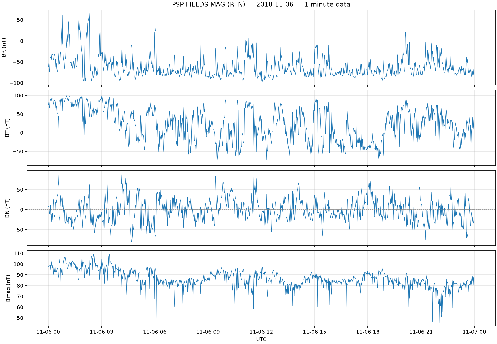
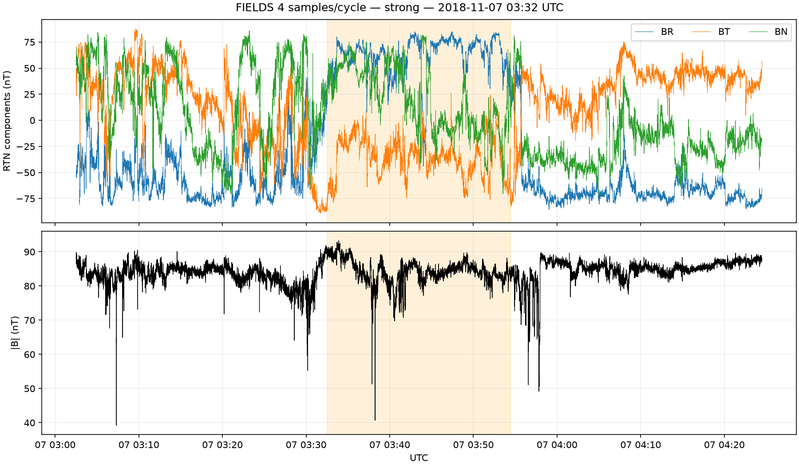
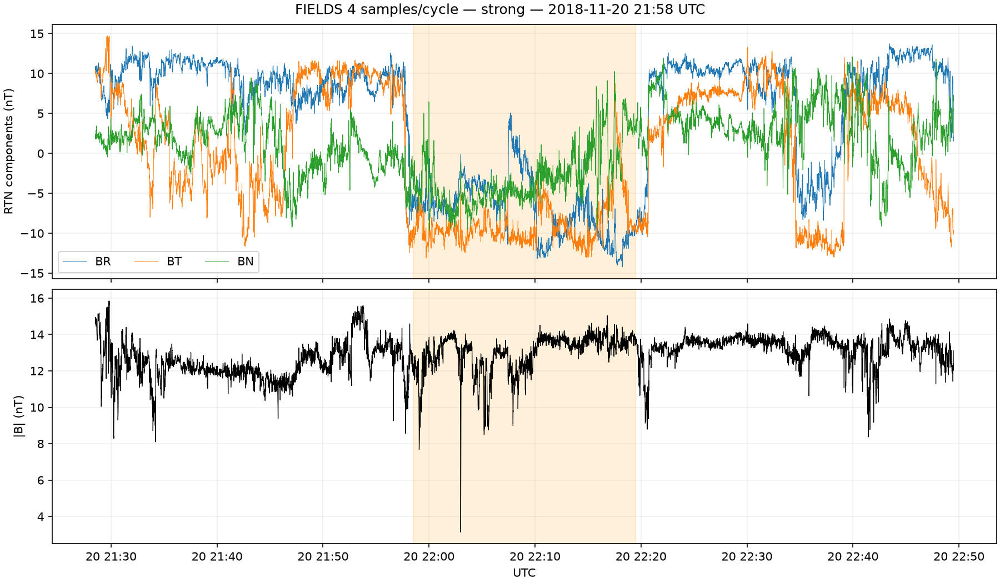
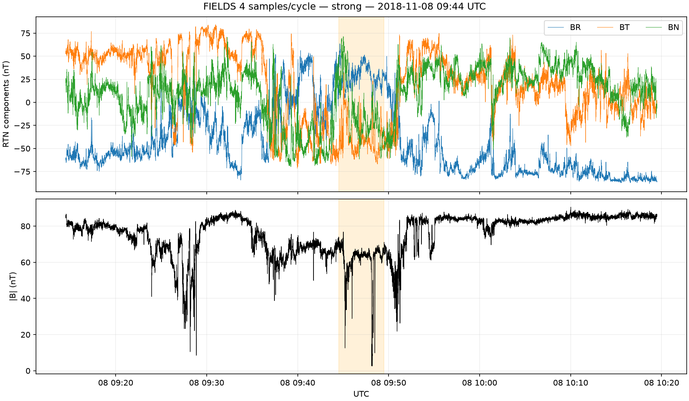
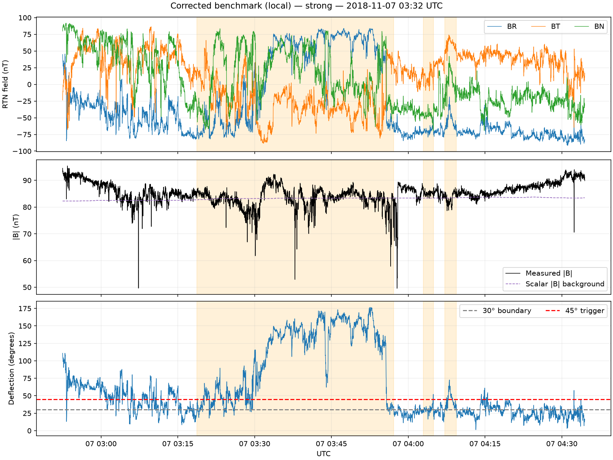
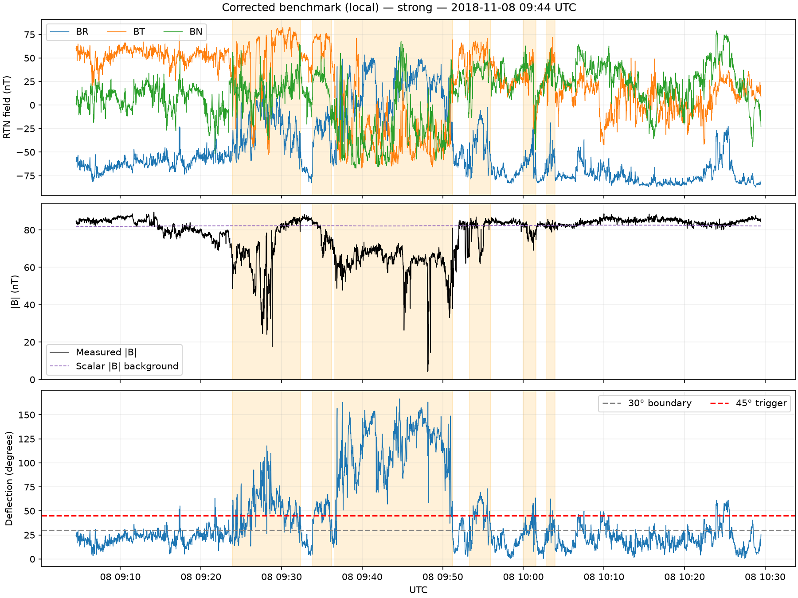

# Project Solar — The Research

## 1. Research Objectives

### 1.1 Identification of Magnetic Switchbacks

Identify magnetic switchback candidates using magnetic-field measurements from Parker Solar Probe's FIELDS instrument.

Examine large rotations of the magnetic-field vector, including reversals of its radial component ($B_R$), and investigate whether the total magnetic-field magnitude ($|B|$) remains approximately constant.

Develop quantitative criteria to distinguish switchbacks from ordinary magnetic fluctuations and other structures.

### 1.2 Characterization of Magnetic Switchbacks

Quantitatively investigate the physical and statistical properties of detected switchbacks:

- **Duration:** How long individual events last.
- **Rotation angle:** The angular deflection of the magnetic field.
- **Magnetic-field magnitude:** Changes in $|B|$ during events.
- **Occurrence rate:** How frequently switchbacks are detected.
- **Event variability:** Differences between individual switchbacks.

Identify recurring patterns and statistical distributions across events.

### 1.3 Relationships with Other Physical Measurements

Investigate correlations between switchback properties and other measurements recorded by Parker Solar Probe.

The investigation may include:

**Spacecraft position and environment**
- Heliocentric distance
- Spacecraft position and trajectory
- Changes across different solar encounters

**Plasma properties (SWEAP)**
- Proton and electron density
- Solar-wind velocity
- Proton and electron temperatures
- Temperature anisotropy
- Ion composition and distribution functions
- Electron heat flux

**Electromagnetic properties (FIELDS)**
- Magnetic-field fluctuations and turbulence
- Electric-field measurements
- Plasma-wave activity and spectral power
- Magnetic and electric-field variability

**Energetic particles (IS☉IS)**
- Energetic ion and electron intensities
- Particle energy spectra
- Directional particle distributions
- Changes in energetic-particle populations near switchbacks

**Derived physical quantities**
- Plasma beta
- Alfvén speed
- Alfvénicity
- Magnetic and plasma fluctuation statistics

The objective is to identify statistically meaningful relationships between magnetic switchbacks and their surrounding physical environment.

Measurements will be compared only where sufficient temporal coverage, resolution, and data quality are available.

Correlations will be interpreted cautiously, distinguishing statistical association from physical causation.

## 2. Scientific Background

### 2.1 The Solar Wind and Its Magnetic Field

The solar wind is a continuous flow of plasma, primarily consisting of protons, electrons, and helium ions, escaping from the solar corona into interplanetary space.

Because the solar wind is electrically conducting, its motion is strongly coupled to the interplanetary magnetic field. As the plasma travels outward, it carries magnetic structures and disturbances away from the Sun.

Parker Solar Probe measures the magnetic field in the RTN coordinate system:

- **R (Radial):** Points outward from the Sun toward the spacecraft.
- **T (Tangential):** Lies perpendicular to R, broadly in the direction of solar rotation.
- **N (Normal):** Completes the right-handed coordinate system.

The magnetic-field magnitude is:

$$
|\mathbf{B}| = \sqrt{B_R^2 + B_T^2 + B_N^2}
$$

These measurements allow us to distinguish changes in magnetic-field direction from changes in magnetic-field strength.

### 2.2 Magnetic Switchbacks

Magnetic switchbacks are large, localized deflections of the magnetic-field vector observed in the solar wind.

During a switchback, the magnetic field can rotate so dramatically that its radial component temporarily reverses relative to the surrounding magnetic-field polarity.

One particularly interesting property is that **the total magnetic-field magnitude often remains approximately constant despite the large directional change**.

Switchbacks are frequently associated with enhancements in solar-wind velocity and other Alfvénic signatures.

The observations suggest that switchbacks represent strongly deflected magnetic structures propagating through or being carried by the solar wind.

However, a reversal of $B_R$ alone does not necessarily establish the presence of a switchback.

### 2.3 Alfvén Waves and Plasma Disturbances

Alfvén waves are disturbances in magnetized plasma involving coupled fluctuations in magnetic fields and plasma velocity.

Their characteristic propagation speed is the Alfvén speed:

$$
v_A = \frac{B}{\sqrt{\mu_0 \rho}}
$$

where:

- $B$ is the magnetic-field magnitude.
- $\rho$ is the plasma mass density.
- $\mu_0$ is the vacuum permeability.

Many switchbacks exhibit Alfvénic behavior: changes in magnetic-field direction are accompanied by correlated plasma-velocity fluctuations.

Studying these relationships may help determine whether particular switchbacks behave like propagating Alfvénic structures and how they interact with the surrounding solar wind.

### 2.4 Proposed Formation Mechanisms

The physical origin of magnetic switchbacks remains an active research topic.

Several mechanisms have been proposed:

#### Interchange Magnetic Reconnection

Magnetic reconnection between open and closed magnetic-field lines near the Sun may release disturbances into the solar wind, potentially providing the initial conditions for switchback formation.

#### Growing Alfvénic Fluctuations

Magnetic fluctuations originating near the Sun may increase in relative amplitude as the solar wind expands, eventually developing into large magnetic deflections or reversals.

#### Solar-Wind Turbulence

Nonlinear interactions between magnetic and velocity fluctuations may produce strongly distorted magnetic structures.

#### Velocity Shear and Plasma Instabilities

Differences in velocity between neighboring solar-wind streams may distort magnetic structures and contribute to the development of switchbacks.

These mechanisms are not necessarily mutually exclusive. Disturbances generated near the Sun may evolve through several processes as they propagate outward.

Current research therefore investigates both the solar origins of magnetic disturbances and their subsequent evolution within the solar wind.

### 2.5 Scientific References

1. [Bale et al. (2019) — Highly structured slow solar wind emerging from an equatorial coronal hole](https://doi.org/10.1038/s41586-019-1818-7)
2. [Kasper et al. (2019) — Alfvénic velocity spikes and rotational flows in the near-Sun solar wind](https://doi.org/10.1038/s41586-019-1813-z)

## 3. Observations and Figures

This section presents observational results obtained from Parker Solar Probe measurements, including magnetic switchback detection, event characterization, statistical distributions, and relationships with other physical quantities.

### 3.1 Preliminary Observations

This section presents our initial observations from Parker Solar Probe FIELDS magnetometer measurements.

The investigation begins with one-minute magnetic-field measurements in RTN coordinates, followed by higher-resolution examination of selected magnetic-rotation candidates.

These observations are preliminary. Candidate events have not yet undergone complete physical and statistical validation.

#### Figure 1 — Initial Magnetic Field Measurements

**Observation date:** November 6, 2018.

The figure shows the radial, tangential, and normal magnetic-field components, together with the total magnetic-field magnitude.

The individual components exhibit substantial temporal variations, including directional reversals.

This overview demonstrates the need for automated screening to identify interesting magnetic structures across extended observation periods.

#### Figure 2 — Promising Magnetic Switchback Candidate

**Observation date:** November 7, 2018, approximately 03:32 UTC.

The measurements reveal a substantial reversal of the radial magnetic-field component, followed by a return toward its previous direction.

The total magnetic-field magnitude appears comparatively stable over much of the interval.

This behavior is consistent with a potential magnetic switchback, although the event requires further validation.

#### Figure 3 — Additional Magnetic Switchback Candidate

**Observation date:** November 20, 2018, approximately 21:58 UTC.

This interval exhibits another pronounced magnetic-field rotation, with a reversal of the radial component.

The event provides an additional example for comparing magnetic-field behavior across different observation periods.

Its physical classification remains preliminary.

#### Figure 4 — Magnetic Rotation with Significant Magnitude Variations

**Observation date:** November 8, 2018, approximately 09:44 UTC.

Unlike the previous examples, this interval exhibits substantial variations in the total magnetic-field magnitude alongside changes in field direction.

This example illustrates why a large magnetic rotation alone is insufficient to establish the presence of a switchback.

Further examination is necessary to determine whether the variations represent physical plasma structures, instrumental effects, or other magnetic disturbances.

#### Preliminary Findings

Our initial investigation demonstrates that:

1. Parker Solar Probe FIELDS measurements contain substantial magnetic-field rotations and radial reversals.
2. Some candidate events exhibit relatively stable magnetic-field magnitude despite large directional changes.
3. Other events exhibit significant magnetic-field magnitude variations.
4. Automated screening can identify intervals for further investigation, but its classifications require validation.

These observations motivate the development of more rigorous switchback detection and characterization methods in Section 3.2.

No population-wide conclusions are drawn from these selected examples.

### 3.2 Switchback Identification and Characterization

#### 3.2.1 Detector and reference definitions

Our benchmark retains the angular detection thresholds used by Laker et al. (2022):
45° trigger, 30° boundary, 10-second minimum duration, and merging separated
segments when the intervening valid-data gap is less than 20 seconds.

For this **local-background benchmark**, the magnetic deflection angle is
calculated against a 181-minute rolling median of the magnetic RTN components:

$$
\theta(t)=\cos^{-1}\left(\frac{\mathbf{B}(t)\cdot\mathbf{B}_{bg}(t)}{|\mathbf{B}(t)|\,|\mathbf{B}_{bg}(t)|}\right).
$$

The independent magnitude reference is the 181-minute rolling median of **scalar**
$|\mathbf{B}|$, not the magnitude of the component-wise median vector.
Magnitude deviations are reported as percentages of this scalar reference.

This benchmark is **not an exact reproduction** of Laker et al.'s Parker-spiral
method. The optional `parker-spc` mode uses good-quality SWEAP SPC Level 3
primary-proton radial velocity, spacecraft HCI position, an assumed 2.5 solar-radius
source surface and local magnetic-sector polarity. It is exploratory: the published
method primarily uses SPAN-i measurements and a filtered velocity reference.

#### 3.2.2 Event catalog and data-quality safeguards

The detector uses one-second median magnetic samples; missing samples are not
interpolated. Each event records a peak angle, estimated start and end, radial
reversal, scalar-field-magnitude deviation, and reference method.

An event that begins or ends at the analysis-window boundary (or adjacent
to a missing angular sample) is **censored**: its complete duration is unknown.
Its `duration_seconds` is left blank, while `observed_span_seconds` is retained.
Duplicated detections from overlapping seed windows are consolidated in the
corrected catalog. All detections remain **unvalidated magnetic rotations**.

#### 3.2.3 Corrected preliminary results

- Selected windows successfully processed: **20**.
- Original seed-associated detections after global deduplication: **57**.
- Duplicate observations consolidated: **4**.
- Boundary/gap-censored detections: **3**.
- Median duration among only uncensored detected intervals: **223 seconds**.
- Median absolute scalar $|B|$ deviation across detected intervals: **6.13%**.

These values describe a deliberately selected set of observation windows. They are
**not** population-wide occurrence rates, event-confirmation statistics, or an
estimate of false-positive rate.

An exploratory SWEAP-SPC Parker-spiral-reference comparison was also run. Its catalog contains **10 unvalidated intervals**. It is NOT the full Laker et al. method.

#### 3.2.4 Selected diagnostic figures

#### 3.2.5 Cross-reference disagreement analysis

A comparison of the **three observation windows processed successfully by both
reference methods** (November 1, 5 and 7, 2018) contained 10 local-reference
detections and 10 Parker-SPC-reference detections. When detections overlapping
by at least 50% of the shorter interval were assembled into connected groups,
there were **eight overlapping groups**: four one-to-one, two where the local
reference split an SPC event, and two where the SPC reference split a local event.
**No groups were exclusive to a single method** under that overlap rule.

The earlier greedy one-to-one comparison's two local-only and two Parker-only
labels were misleading: these intervals temporally overlapped detections from
the other method but could not be matched one-to-one. The actual discrepancies
primarily concern **event segmentation and boundary placement**.

This result shows timing overlap of magnetic rotations, **not confirmation of
physical switchbacks, algorithm accuracy, or a population-wide detection rate**.
See the [full disagreement audit](results/reference_disagreement_audit.md).
The revised `compare_detectors.py` also exports overlap groups and pairs.

#### 3.2.6 Independent-reference validation (in progress)

The new [angle-comparison script](validate_reference_methods.py) overlays the
deflection angles and boundaries of both methods at identical FIELDS timestamps.
It creates diagnostic figures and an initially unlabeled review worksheet.
The checks cover the four segmentation disagreements, the Laker et al.
August 31, 2019 example, and an independent
[E1-E2 visual switchback catalog](https://zenodo.org/records/4579821).
The independent catalog uses a different event definition.
**No detector accuracy comparison is complete yet.**

#### 3.2.7 Remaining validation

A full replication must reproduce the published plasma-based Parker-spiral
reference (including SPAN-i primary measurements and smoothing), apply consistent
quality flags, test threshold sensitivity, independently review candidates and
non-candidates, and quantify false positives and missed events before scaling to
multi-year statistical results.

**Reference:** [Laker et al. (2022)](https://academic.oup.com/mnras/article/517/1/1001/6692877).

### 3.3 Statistical Results

*To be added:*

- Distribution of switchback durations.
- Distribution of magnetic-field rotation angles.
- Switchback occurrence rates.
- Comparison of event properties across observation periods.
- Statistical patterns and variability.

### 3.4 Relationships with Other Physical Measurements

*To be added:*

- Relationships with heliocentric distance.
- Solar-wind velocity and Alfvénic behavior.
- Plasma density and temperature.
- Magnetic and electric-field fluctuations.
- Plasma-wave activity and turbulence.
- Energetic-particle intensity and energy spectra.
- Derived plasma quantities and statistical correlations.
- Assessment of statistical significance and measurement limitations.

## 4. Analysis and Discussion

## 5. Conclusions

## 6. References
